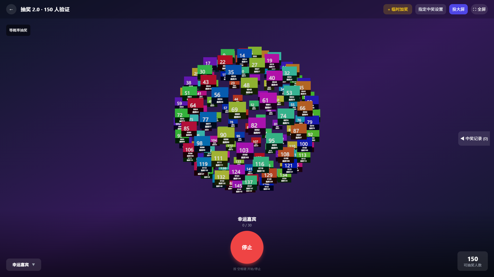
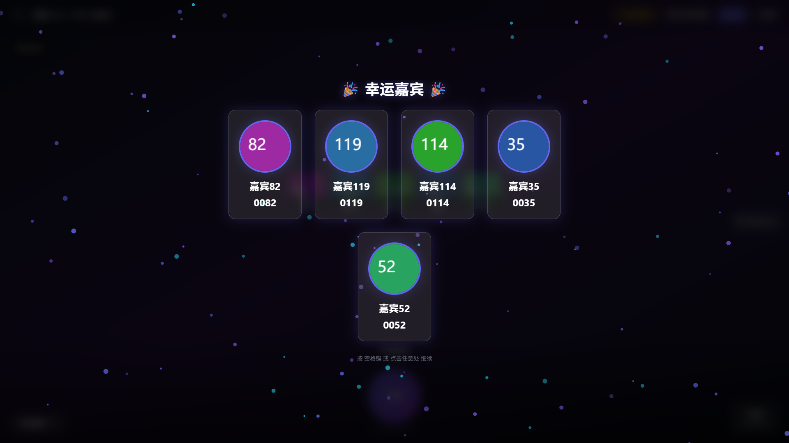
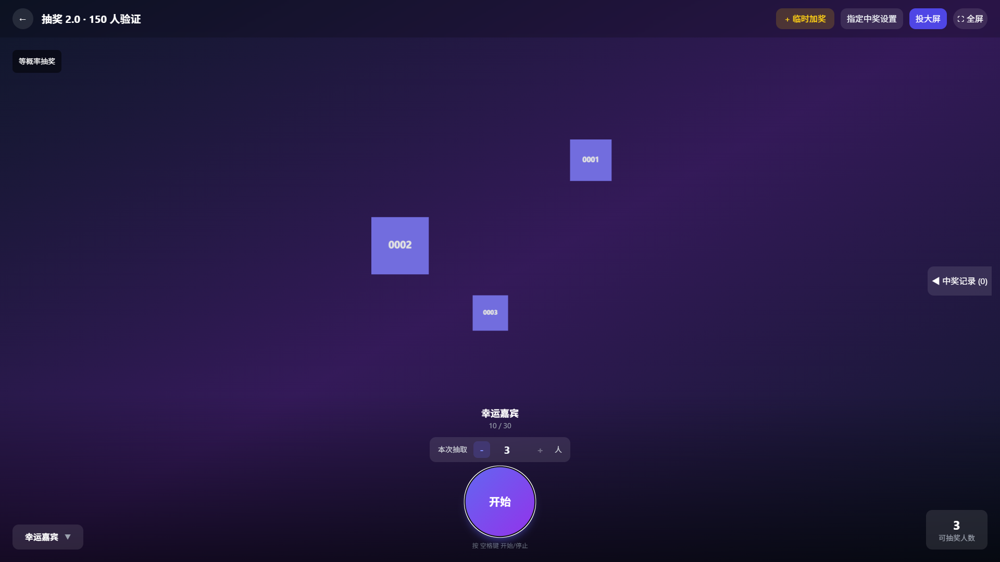

# 年会与婚礼抽奖 (Annual Lucky Draw) v2.0

基于 Electron、React 18、Three.js 0.160 与 React Three Fiber 的离线桌面抽奖应用。无需联网即可在活动现场运行，覆盖**公司年会**、**婚礼姓名抽奖**与**纯号码抽奖**三大场景。

> 英文旧版说明保留于 `README.en.md`（尚未同步 v2.0 内容，以本中文文档为准）。

---

## 核心特性与 2.0 升级亮点

- **三种抽奖模式**：
  - **常规 3D 球体抽奖**：支持单次抽取 `1–30` 人，球体转速可调（`0.5–6.0` 弧度/秒）。
  - **轮盘抽奖**：先选定抽奖人，再转动奖品轮盘抽取对应奖品。
  - **终极大奖**：按员工积分（`points > 0`）计算权重抽取大奖。
- **百人以上照片稳定无闪烁**：
  - 移除旧版每 100ms 随机重排截断逻辑，改为每张卡片固定复用单张 `CanvasTexture`，照片异步解码完成前显示文字底卡，消除 `> 60` 人时的闪现、白卡与跳位（详见[根因与验收分析](docs/lottery-2-validation.md)）。
  - `180` 人以内同屏完整展示；超过 `180` 人时每 `8` 秒按固定顺序轮播翻页，**全体符合资格的人员始终参与实际抽取**。
- **动画与结果严格一致**：
  - 点击开始时冻结本轮奖池，点击停止或按空格键时使用 Web Crypto 均匀无放回抽样（或加权抽样）一次性得出结果，并在同一 IndexedDB（Dexie）事务中原子写入人员与奖项表，3D 场景定格卡片与中奖弹窗完全同源。
- **灵活的显示字段与场景预设**：
  - **照片、姓名、工号/号码、部门**四项独立开关，同时作用于 3D 球体卡片、中奖弹窗、轮盘抽奖与终极大奖界面。
  - 一键切换**“只显示姓名”**（适合婚礼/晚会）或**“只显示号码”**（适合入场券/纯序号抽奖）。
  - 卡片直接展示真实工号/号码，不再显示容易误导的渲染下标。
- **无工号与纯号码导入支持**：
  - Excel 导入与手动添加均只要求**“姓名”或“工号/号码”至少填一项**。
  - 缺省工号自动生成独立编号（如 `N000001`），同名人员不会合并或互相覆盖；支持保留 Excel 文本或 `0000` 数字格式中的前导零。
- **一键投大屏**：
  - 抽奖页顶部提供**“投大屏”**按钮，自动列出系统已连接的显示器，将当前抽奖窗口移至目标屏幕并开启全屏。
- **跨电脑配置迁移**：
  - 支持将全套活动数据（人员名单、裁剪头像、奖项与奖品图、中奖记录、主题、自定义背景、Logo、音乐及高级设置）打包导出为单个 `.json` 文件，拷到另一台电脑一键校验恢复。

---

## 界面预览（合成测试数据）

| 150 人合成照片球体展示 | 单次抽取 5 人中奖展示 |
|---|---|
|  |  |
| **纯号码抽奖模式（隐藏姓名/部门/照片）** | **少人数（3 人）避开旋转轴两极分布** |
|  |  |

---

## 下载与平台选择

正式发版资产请前往仓库 **Releases** 页面下载（开发分支的 GitHub Actions 临时构建产物仅保留 14 天且需登录下载，不作为永久发布链接）：

| 操作系统与芯片架构 | 推荐安装包文件名 | 说明 |
|---|---|---|
| **Windows 10 / 11 (x64)** | `年会抽奖-2.0.0-Setup.exe` | 标准 NSIS 安装程序 |
| **macOS Apple Silicon (M1–M4)** | `Annual-Lucky-Draw-2.0.0-arm64.dmg` (或 `.zip`) | 适用于 Apple 芯片 Mac |
| **macOS Intel (x64)** | `Annual-Lucky-Draw-2.0.0-x64.dmg` (或 `.zip`) | 适用于 Intel 芯片 Mac |

> **系统安全提示说明**：当前提供的安装包未经商业代码签名与 Apple 公证（Notarization）。
> - **Windows** 首次运行若弹出 SmartScreen 提示，请点击“更多信息” → “仍要运行”。
> - **macOS** 首次打开若提示“无法验证开发者”或“已损坏”，请在“系统设置 → 隐私与安全性”中点击“仍要打开”，或在终端对应用执行 `xattr -cr /Applications/年会抽奖.app`。

---

## 快速开始

推荐按以下顺序准备活动：**数据导入 → 奖项设置 → 外观设置 → 音效设置 → 配置迁移（备份） → 进入抽奖**。

### 1. 导入名单与照片（数据导入）
1. 点击 **📥 下载模板** 查看示例格式，或直接选择已有的 `.xlsx / .xls` 文件。
2. **字段要求**：
   - **公司年会**：可包含工号、姓名、部门、照片文件名、积分（可选）。
   - **婚礼/晚会（无工号）**：只需填写“姓名”列，工号留空即可，系统会自动分配如 `N000001` 的独立编号，同名嘉宾不会被合并。
   - **纯号码抽奖**：只需填写“工号/号码”列，姓名可留空。若需保留 `0001` 等前导零，请在 Excel 中将单元格设为文本格式或自定义 `0000` 显示格式。
3. **照片匹配（可选）**：选择照片文件夹后，系统按 **「Excel 中的照片文件名 → 工号 → 姓名」** 顺序自动匹配图片（支持 `jpg / png / gif / webp`）。也可在下方列表中手动添加人员并裁剪上传头像。
4. **导入方式**：
   - **增量导入**：按工号合并更新现有人员（保留已中奖状态與已有照片）；**注意**：无工号导入每次都会生成新编号并作为新人员追加，如需增量更新同一人，请先导出当前名单并保留其编号。
   - **覆盖导入**：清空现有名单重新导入（若已有中奖记录，须先在顶部点击“清除记录”）。

### 2. 设置奖品与名额（奖项设置）
1. 支持手动添加奖项或通过 Excel 批量导入奖项（识别列名：`奖项名称/奖项`、`数量/名额`、`包含已中奖/返场抽奖`、`临时奖项`）。
2. 可为每个奖项上传奖品图片，并设置是否允许**“包含已中奖人员（返场抽奖）”**。即使开启返场，同一人员在**同一个奖项**内也绝不会重复中奖。
3. 抽奖现场还可通过右上角 **+ 临时加奖** 随时追加老板临时奖。

### 3. 调整显示字段与转速（外观设置）
1. **主题与背景**：内置“深色科技”“白色极简”“🏮 红色过年”三套主题，支持上传自定义背景图（建议 `1920×1080`）、公司 Logo 与活动标题。
2. **显示选项**：自由勾选 `照片`、`姓名`、`工号 / 号码`、`部门`，或直接点击 **「只显示姓名」**、**「只显示号码」** 预设按钮。
3. **球体转速**：拖动滑块在 `0.5` 至 `6.0` 弧度/秒之间调节滚动旋转速度。

### 4. 现场投屏与操作（进入抽奖）
1. 先通过 HDMI 线或操作系统自带的无线投屏连接大屏幕（建议使用系统“扩展这些显示器”模式）。
2. 进入抽奖页后，点击右上角 **「投大屏」**，选择目标显示器，当前抽奖窗口会自动移至该屏幕并全屏显示（按 `F11` 或点击全屏按钮可退出全屏）。
   > 注：投屏功能基于单窗口移动与全屏，并非远程网页推流或双窗口独立导播台。
3. **常用快捷键**：
   - `Space（空格键）`：开始滚动 / 停止并揭晓结果 / 关闭中奖弹窗（遵循当前设定的“本次抽取人数”）。
   - `←` / `→`：在待机状态下切换上一个 / 下一个奖项。
   - `F11`：切换全屏。
   - `Esc`：关闭弹窗或从待机状态返回配置页。

---

## 高级概率与定向配置说明

为了保证活动大屏的简洁与纯粹，抽奖画面全程**不会显示**任何概率模式或定向配置提示：

1. **终极大奖积分（公开模式）**：
   - 在「数据导入 → 员工数据管理」中为员工设置 **积分（`points`）**。
   - 点击顶部 **🏆 终极大奖** 进入专属页面，系统仅筛选 `积分 > 0` 的未中奖人员，并按 `个人积分 ÷ 总积分` 计算中奖概率。
2. **常规抽奖隐蔽高级设置（权重采样与定向分配）**：
   - **设置人员优先级系数**：在「数据导入 → 员工数据管理」中点击编辑人员（✏️），设置 **优先级系数（`1–100`，默认 `1`）**，或在 Excel 中添加 `权重` / `weight` 列导入。
   - **打开隐蔽面板**：在常规抽奖页**待机状态（未滚动）**下，连续快速点击右下角 **「可抽奖人数」** 卡片 **5 次**，即可唤出 **「⚙ 高级设置」** 面板（一旦点击开始抽奖，该面板会自动关闭且在滚动期间无法唤出）：
     - **抽奖采样模式**：可在 `标准均匀`（默认等概率）与 `系数加权`（按优先级系数无放回加权抽取，首抽概率 = 个人系数 ÷ 剩余池总系数）之间切换。
     - **启用定向分配**：开启后可为指定奖项搜索并绑定特定人员，抽奖停止时优先从符合资格的绑定名单中产出结果，不足名额再由常规抽样补齐。

---

## 配置保存、跨电脑迁移与升级注意事项

- **为什么拷贝安装包不能带走配置？**
  本应用的所有人员、照片与奖项存储在当前电脑的本地数据库（IndexedDB）与本地存储（localStorage）中，直接复制 `.exe / .dmg` 安装程序不会携带任何活动数据。
- **如何换电脑迁移配置？**
  1. 在原电脑打开 **「💾 配置迁移」** 标签页，点击 **「导出完整配置」**，生成 `抽奖活动配置.json` 文件。
  2. 将该 `.json` 文件拷贝到目标电脑，在新电脑打开「配置迁移」并点击 **「导入配置」** 即可完整恢复名单、照片、奖项、中奖记录、主题、背景、Logo、音乐及高级设置。
- **体积与回退保护**：
  - 导入配置文件上限为 `100 MB`；浏览器本地存储对背景图与音频文件有配额限制（建议选用精简的 MP3 音频与压缩背景图）。
  - 导入时若遇到文件损坏、字段引用不合法或存储空间超限，系统会拒绝导入并**自动回退保留原有活动数据**。
- **从 v1.x 升级提示**：
  - 代码保留了旧版头像开关与存储键的兼容迁移逻辑，但在覆盖安装或升级前，强烈建议先导出 Excel 名单与中奖记录进行备份。

---

## 开发与构建

推荐环境：**Node.js 22 LTS**。

```sh
# 1. 安装依赖（严格遵循锁文件）
npm ci

# 2. 启动本地开发模式
npm run dev

# 3. 类型检查、单元/集成测试与网页端生产构建
npm run typecheck
npm test
npm run build:web

# 4. 桌面端打包（Windows 在 Windows 机器构建，macOS 在 Mac 构建）
npm run dist:win
npm run dist:mac
```

若在 Windows 非管理员环境下因缺少符号链接权限导致 `dist:win` 报错，可先执行 `npm run build:web`，再运行以下命令生成未签名验收包：

```sh
npx electron-builder --win --publish never --config.win.signAndEditExecutable=false
```

---

## 验证范围与已知边界

详细技术根因、自动化测试覆盖及现场复现步骤请参阅 **[抽奖 2.0：根因与验收](docs/lottery-2-validation.md)**，自动化验收产物见 **[docs/verification/](docs/verification/)**。

- **已完成自动化与实测验证**：
  - TypeScript 类型检查、28 项 Vitest 单元与场景测试（含 React Three Test Renderer 下 150 张卡片 10 次重渲染零新建纹理、卸载释放全部 150 张纹理）、生产构建通过。
  - 本机 Chrome（1920×1080，WebGL 硬件渲染）150 张合成照片连续滚动纹理计数恒定（创建 154、删除 0）、键盘单次抽 5 人显示与数据库持久化一致、纯号码与隐藏部门生效、3 人球面分布逐一运动通过。
  - Windows 打包解包程序（`release/win-unpacked/年会抽奖.exe`）隔离目录启动、`webSecurity` 开启及显示器列表 IPC 调用验证通过。
- **已知边界与使用建议**：
  - 超过 180 人采用每页 180 人的顺序轮播分页机制控制显存占用，并非同屏渲染上千张高清大图纹理。
  - 物理外接显示器投屏、macOS Intel / Apple Silicon 实机安装及长时间（如连续 60 秒 × 10 轮）现场压力测试，建议活动开始前在实际演出设备上按验收清单走查一遍。

---

## 许可证

[MIT](LICENSE)
